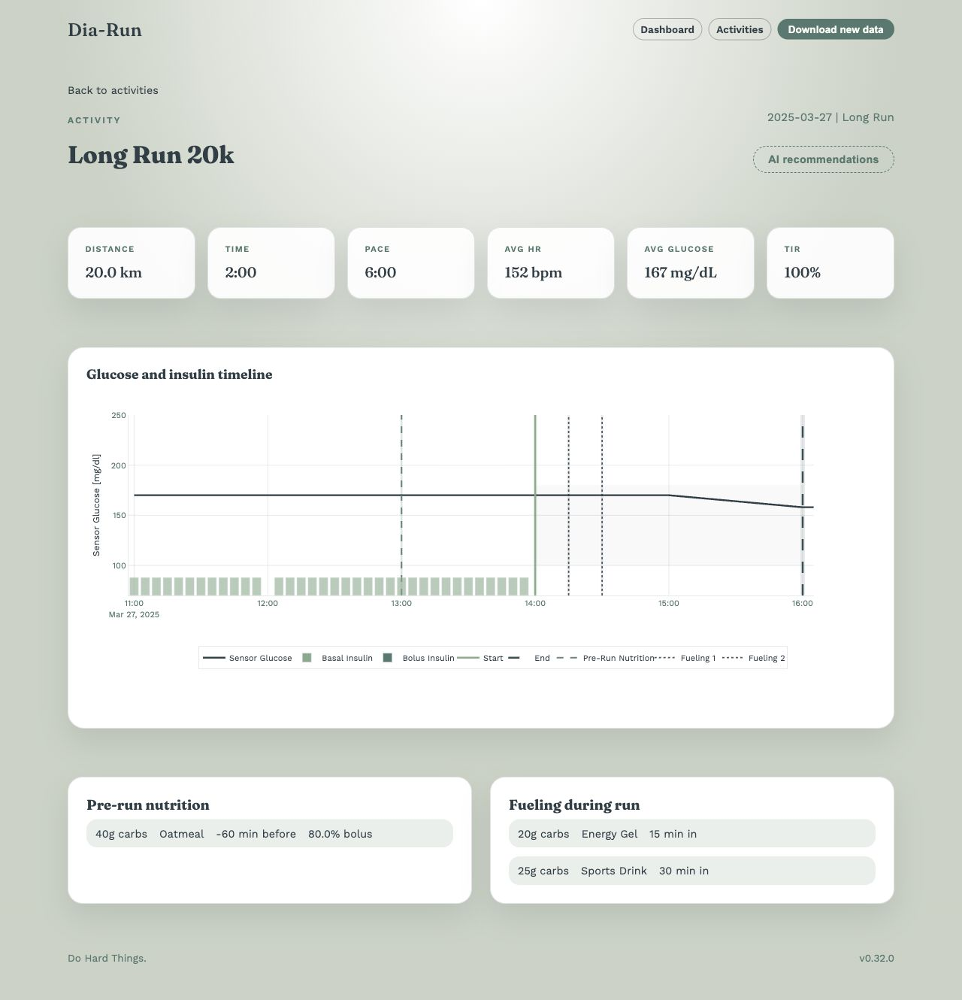

# Dia-Run

Dia-Run brings Strava running activities and Medtronic CareLink glucose and insulin data together in an interactive dashboard. Add context about fueling, nutrition, and basal adjustments to explore how your runs and glucose patterns relate.



*Activity detail shown with synthetic test data.*

## What it does

- Shows pace and heart-rate summaries alongside a timeline of glucose, insulin, and fueling events.
- Compares runs by type, distance, glucose outcomes, and preparation.
- Records pre-run nutrition, basal settings, fueling, and boluses through a questionnaire.
- Provides optional AI run recommendations through OpenRouter.
- Includes a mock-data mode for exploring the app without connected accounts.

Built with **Python 3.12**, **FastAPI**, **Jinja2**, and **Plotly**, with **Polars** for processing, **Delta Lake** for storage, and **Pandera/Pydantic** for validation.

## Quick start

With Python 3.12 and `uv` installed, run these commands from the repository root:

```bash
uv sync
cp .env.example .env
```

To explore with synthetic data, set `USE_MOCK_DATA=true` in `.env`, then start the app:

```bash
uv run uvicorn dia_run.web.app:app --reload
```

Open [localhost:8000](http://localhost:8000) and click **Download new data** to generate a sample run. Complete its questionnaire, then explore the dashboard and activity details. Repeat to add more runs.

Mock mode stores generated data in `./mock-data/` and does not call Strava or CareLink. Live data is stored in `./data/` by default.

## Connect your accounts

Set `USE_MOCK_DATA=false` in `.env` before using live data.

1. **Strava:** Create a Strava API application with `localhost` as its authorization callback domain. Add its `CLIENT_ID` and `CLIENT_SECRET` to `.env`.
2. **CareLink:** With Firefox installed, run the setup command below and follow the login flow. It creates `logindata.json` in the repository root. Add `--us` for a US account.

   ```bash
   uv run src/dia_run/data_fetcher/carelink_setup.py
   ```

3. **First import:** Run the fetch command from a terminal. Follow the Strava authorization flow and paste the redirected URL when prompted. The command then imports data and opens the run questionnaire.

   ```bash
   uv run fetch
   ```

After setup, use **Download new data** in the web app or `uv run fetch` for subsequent imports. Questionnaires can also be completed or edited in the web app.

The importer checks the latest Strava activity and imports it only if it is a run. CareLink supplies recent data rather than a full historical archive, so import soon after a workout.

## Optional features

**AI recommendations:** Set `OPENROUTER_API_KEY` in `.env` to enable recommendations on activity pages. Requests send run and health context to OpenRouter and the selected model provider. `OPENROUTER_MODEL` selects the model.

**Docker:** After completing account setup locally, start the web app with:

```bash
docker compose up --build
```

The local Compose configuration mounts `.env`, `logindata.json`, and `./data/`. Open [localhost:8000](http://localhost:8000).

**Deployment:** See the [Lightsail deployment guide](docs/lightsail_deployment.md) for production Docker Compose, WireGuard access, S3 sync, and recovery. Email alert setup is covered in the [SES guide](docs/ses_setup.md).

## Development

Install the commit hooks and run the project checks:

```bash
uv run pre-commit install
uv run pre-commit run --all-files
uv run pytest
```

The hooks run Ruff linting and formatting plus mypy type checking. CI runs the test suite on pull requests into `develop` and `main`.

The code follows a data pipeline: API clients → validated data models → processing → charts and web views. See the [architecture diagram](docs/diagram.mmd) for the class and module relationships.

Create feature branches from `develop` and open pull requests back into `develop`. Production releases reach `main` through `release/*` or `hotfix/*` branches. See [AGENTS.md](AGENTS.md) for coding conventions and the release workflow.
